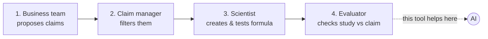
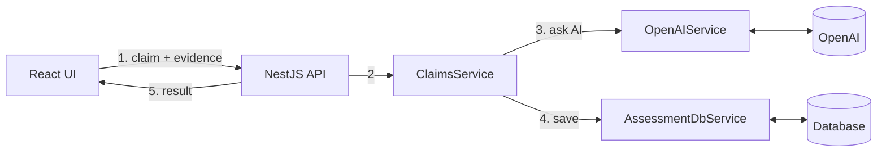
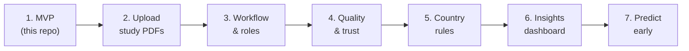

# Claims Validator using LLM

### Technical Proposal: L'Oréal Claims Intelligence Engine

> [!NOTE]
> **Summary**
> - **What:** a tool that checks whether a clinical study really proves a product claim, such as *"Reduces wrinkles by 20% in 4 weeks"*.
> - **How:** an LLM (OpenAI) reads the claim and the study results, then returns **Justified: Yes/No**, a **confidence score** and its **reasoning**.
> - **Why:** checking claims by hand is slow, inconsistent and hard to audit. The AI gives a fast first opinion, and the expert makes the final decision.
> - **Status:** working code in this repo: NestJS + Prisma + React. See the [README](README.md) to run it.

---

## Contents

1. [Business process understanding](#1-business-process-understanding)
2. [Research performed](#2-research-performed)
3. [Solution](#3-solution)
4. [Architecture justification](#4-architecture-justification)
5. [Product roadmap](#5-product-roadmap)

---

## 1. Business process understanding

> **In short:** every claim on a beauty product must be proven by a study. This tool speeds up the final "is it proven?" step.

### How a claim reaches the product pack

1. **Business team:** proposes a product and the claims to print on it.
2. **Claim manager:** keeps only claims that are *allowed* and *possible to prove*.
3. **Scientist:** builds the formula and submits it with the claim.
4. **Evaluator:** looks at the clinical study and decides whether it proves the claim.

### The problem at step 4

Laws in the EU and the US say a cosmetic claim **must be backed by evidence**. Today that check is manual, which makes it:

- 🐢 **Slow:** long study reports for every claim, product and country.
- 🎲 **Inconsistent:** two reviewers can reach different answers.
- 📂 **Hard to audit:** the *reason* a claim was approved is often not recorded.

### What the tool changes

| Before | After |
| --- | --- |
| The evaluator reads every study from scratch | The AI gives an instant first opinion with reasons |
| The decision lives in someone's head or email | Every verdict is saved with its reasoning and model version |
| Results vary by reviewer | The same input gets the same answer (temperature 0) |

> **The human stays in charge.** The AI *recommends*; the evaluator *decides*.

---

## 2. Research performed

> **In short:** I found the six things experts check in a study and built them into the AI's instructions.

### What makes a study "good enough" to prove a claim

| ✅ The study should… | ❌ Red flag example |
| --- | --- |
| Compare against a **placebo or control group** | No comparison group at all |
| Use **enough people** | Only 12 participants |
| Run **as long as the claim says** | 2-week study for an "in 4 weeks" claim |
| **Measure the right thing** | "Skin feels smoother" (opinion) used for "reduces wrinkle depth" |
| Show **at least the claimed effect** | 14% measured for a "20%" claim |
| Be **statistically significant** | No p-value, or p > 0.05 |

*Sources reviewed: EU Regulation 655/2013 (common criteria for cosmetic claims), the US FTC "competent and reliable scientific evidence" standard, and common clinical practice in dermatology.*

### How I made the AI reliable

- **Fixed answer format (JSON):** it always returns `justified`, `confidence` and `reasoning`, never free text.
- **Temperature 0:** the same input gives the same answer.
- **A clear meaning for "confidence":** how sure the AI is of *its own verdict*.
  *Found in testing:* the AI first read it as "chance the claim is true", so a confident "No" showed as 20%. Fixed in the prompt.
- **The AI's answer is checked:** bad or missing fields become a clean error, never bad data in the database.
- **Audit trail:** the exact model version and raw response are saved with each result.

### Test results

| Claim | Evidence | Result |
| --- | --- | --- |
| Reduces wrinkles by 20% in 4 weeks | 120 women, placebo-controlled, 4 weeks, −22% vs −3%, p<0.01 | ✅ **Justified** (95% sure) |
| Reduces wrinkles by 20% in 4 weeks | 12 women, 2 weeks, self-reported, no control group | ❌ **Not justified** (95% sure) |

---

## 3. Solution

> **In short:** React form → NestJS API → OpenAI → saved in the database → shown on screen.

### How one request flows

### 🗄️ Database: [`schema.prisma`](backend/prisma/schema.prisma)

Two tables:

- **Claim:** *what* we promise, e.g. "Reduces wrinkles by 20% in 4 weeks".
- **Assessment:** *one check* of that claim: the evidence, the verdict, the confidence, the reasoning and which AI model was used.

**One claim can have many assessments**, so a claim can be re-checked with new evidence and the full history is kept.

### ⚙️ Backend: NestJS

| Endpoint | What it does |
| --- | --- |
| `POST /api/claims/assess` | Checks a claim and saves the result |
| `GET /api/claims/assessments` | Lists the latest 50 results |

Each class has **one job**:

| Class | Its job |
| --- | --- |
| [`ClaimsController`](backend/src/claims/claims.controller.ts) | Receives requests and validates input |
| [`ClaimsService`](backend/src/claims/claims.service.ts) | Coordinates: ask the AI, then save |
| [`OpenAIService`](backend/src/openai/openai.service.ts) | The **only** place that talks to OpenAI |
| [`AssessmentDbService`](backend/src/claims/assessment-db.service.ts) | The **only** place that talks to the database |

### 🖥️ Frontend: [`ClaimAssessor.jsx`](frontend/src/ClaimAssessor.jsx)

- A form for the **claim** and the **evidence**.
- Shows **Justified: Yes/No**, **Confidence** and **Reasoning**, colour-coded.
- A **history table** of previous checks.

---

## 4. Architecture justification

> **In short:** each part is chosen to be easy to change, easy to audit and easy to run.

| Choice | Why |
| --- | --- |
| **NestJS** | A clear structure for enterprise APIs: modules, dependency injection and built-in validation |
| **AI code in its own class** | Swap OpenAI for Azure OpenAI, Claude or an in-house model without touching business logic |
| **Database code in its own class** | Change storage or add caching without touching the rest |
| **Prisma** | Type-safe database code, versioned migrations, works with many databases |
| **SQLite now, PostgreSQL later** | Reviewers can run it with no setup. Switching is a one-line change and the code stays the same |
| **Check the AI's answer** | AI output is treated like user input: never trusted blindly |
| **Save model + raw response** | Show regulators exactly which AI said what, and when |
| **React + Vite** | A simple, fast setup; the component can plug into any existing L'Oréal app |

### Current limitations (honest view)

- Evidence is typed or pasted as text; PDF upload isn't supported yet.
- No login or user roles yet.
- The AI hasn't yet been compared with real expert decisions.
- No automated tests yet.

---

## 5. Product roadmap

> **In short:** from a single-screen checker to a full claims platform.

| Phase | What we add | Value |
| --- | --- | --- |
| **1. MVP** ✅ | Text in → verdict out, saved with history | Proves the idea works |
| **2. Evidence upload** | Upload study PDFs; the AI quotes the exact page and line | Evaluators can verify every statement |
| **3. Workflow** | Logins for each role, claim statuses, human approve or override, audit log | Fits the real 4-step business process |
| **4. Quality and trust** | Score per check (sample size, duration…), compare the AI with past expert decisions, version prompts | Measurable accuracy and confidence in the AI |
| **5. Country rules** | Different rules for EU, US, China and India; suggest safer wording ("up to 20%") | Launch faster in more markets |
| **6. Insights** | Dashboard of success rates by brand, search across all past studies | Reuse evidence, cut duplicate studies |
| **7. Predict early** | Estimate a new claim's chance of being proven *before* running a study | Save time and money at step 2 |
